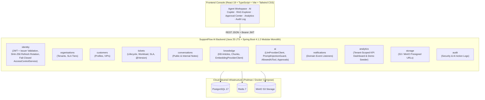

# SupportFlow AI

> **Enterprise AI-Native Customer Support Platform** — Intelligent ticket triage, grounded RAG knowledge assistance with verifiable chunk citations, controlled AI agent tool calling with human approval gates, and a modular monolith architecture built with **Java 25 LTS**, **Spring Boot 4.1.2**, **Spring Modulith 2.1.2**, **PostgreSQL 17**, and **React 19 + TypeScript**.

---

## Product Overview

**SupportFlow AI** combines multi-tenant customer support operations with grounded, auditable AI workflows:

1. **Customer & Organisation Management** (`organisations`, `customers`): Multi-tenant organisations with tiered SLA policies (`ENTERPRISE`, `BUSINESS`, `STANDARD`), response/resolution targets, and VIP customer profiles.
2. **Customer Support Ticket Management** (`tickets`): Full ticket lifecycle (`OPEN`, `IN_PROGRESS`, `ESCALATED`, `RESOLVED`, `CLOSED`), optimistic locking (`@Version`), automatic SLA deadline calculation, and breach tracking.
3. **Agent Assignment & Workload Management** (`tickets`): Real-time agent assignment and active/high-priority/escalated workload balancing.
4. **Omnichannel Conversation & Message Management** (`conversations`): Public customer/agent threads alongside internal-only agent notes (strictly hidden from `CUSTOMER` callers) and AI-assisted draft replies.
5. **SLA Tracking & Event-Driven Escalation** (`tickets`, `notifications`): Automated SLA calculation and domain-event notifications when tickets are created or escalated.
6. **AI Ticket Classification & Prioritisation** (`ai`): Classification of ticket category, priority, urgency sentiment, confidence score, and triage rationale via [`LlmProviderClient`](backend/src/main/java/com/supportflow/ai/LlmProviderClient.java) with transparent local deterministic fallback.
7. **Knowledge Base & Chunk Indexing** (`knowledge`): Technical resolution article authoring, paragraph/sentence chunk segmentation (`knowledge_chunks`), and embedding generation via [`EmbeddingProviderClient`](backend/src/main/java/com/supportflow/knowledge/EmbeddingProviderClient.java) (supporting OpenAI-compatible `/v1/embeddings` when configured or deterministic 12-dimension domain concept vectors in €0/month demo mode).
8. **RAG-Powered Hybrid Chunk Search** (`knowledge`): Tenant-filtered cosine similarity + lexical overlap scoring across `knowledge_chunks` with a minimum relevance threshold (`0.25`) so unverified articles are never returned.
9. **AI-Generated Response Suggestions with Citations** (`ai`): Synthesizes grounded customer replies with inline `[KB-xxx]` citations, refuses to fabricate citations when KB evidence is below threshold, and explicitly reports `providerUsed`, `modelUsed`, and `fallbackUsed`.
10. **Conversation Summarisation** (`ai`): Generates executive handoff summaries, key customer pain points, and recommended next steps with explicit provider/fallback metadata.
11. **AI Agents with Controlled Tool Calling** (`ai`): Enforces a strict enum allowlist ([`AllowedAiTool`](backend/src/main/java/com/supportflow/ai/AllowedAiTool.java): `ISSUE_SLA_SERVICE_CREDIT`, `ESCALATE_TO_TIER3_ENGINEERING`, `UPDATE_SLA_TIER`, `CLOSE_DUPLICATE`) and screens inputs with [`PromptInjectionGuard`](backend/src/main/java/com/supportflow/ai/PromptInjectionGuard.java).
12. **Human-in-the-Loop Approval for Consequential Actions** (`ai`): Consequential AI tool calls enter a `PENDING` governance queue (`ai_approval_requests`) and execute only after an authorized `AGENT` or `ADMIN` within the tenant approves them.
13. **Tenant-Scoped Support Analytics & Reporting** (`analytics`): Real-time KPI dashboard (ticket volume by priority, SLA compliance rate, AI triage coverage, pending approvals, agent workloads) scoped to the caller's tenant via [`AccessControlService`](backend/src/main/java/com/supportflow/identity/security/AccessControlService.java).
14. **Fail-Closed Security & Immutable Audit Logs** (`identity`, `audit`): Strict JWT `iss` (`supportflow-ai`) verification, SHA-256 hashed refresh token rotation with reuse detection, fail-closed multi-tenant RBAC (`CUSTOMER`, `AGENT`, `ADMIN`), and tamper-evident audit logging.

---

## Feature Implementation Matrix

| Feature / Capability | Module | Status | Phase |
| :--- | :--- | :---: | :---: |
| Java 25 + Spring Boot 4.1.2 + Spring Modulith 2.1.2 + Flyway (`V1`–`V6`) | `backend` | **Implemented & Verified** | Phase 1 |
| Strict JWT Auth (`iss` verified), Hashed Refresh Token Rotation & Fail-Closed RBAC | `identity` | **Implemented & Verified** | Phase 2 |
| Tenant-Scoped Security & AI Governance Audit Trail (`/api/audit-logs`) | `audit` | **Implemented & Verified** | Phase 2 |
| Multi-Tenant Organisations & Tiered SLA Policies (`/api/organisations`) | `organisations` | **Implemented & Verified** | Phase 3 |
| Customer Profiles & VIP Escalation Rules (`/api/customers`) | `customers` | **Implemented & Verified** | Phase 3 |
| Support Tickets, Optimistic Locking, Workload & SLA Escalation (`/api/tickets`) | `tickets`, `notifications` | **Implemented & Verified** | Phase 3 |
| Omnichannel Conversations & S3/MinIO Attachments (`/api/tickets/{id}/messages`) | `conversations`, `storage` | **Implemented & Verified** | Phase 3 |
| Knowledge Base Chunking & Hybrid Embedding Search (`/api/knowledge`) | `knowledge` | **Implemented & Verified** | Phase 4 |
| Grounded AI Triage, RAG Citations, Summarisation & Fallback Transparency (`/api/ai`) | `ai` | **Implemented & Verified** | Phase 4 |
| Controlled AI Agent Tool Allowlist & Human Approval Gate (`/api/ai/approvals`) | `ai` | **Implemented & Verified** | Phase 4 |
| Tenant-Scoped Support Analytics & Safe Non-Prod Demo Seeder (`/api/analytics/dashboard`) | `analytics` | **Implemented & Verified** | Phase 5 |
| React 19 + TypeScript + Vite + Tailwind CSS + TanStack Query Console | `frontend` | **Implemented & Verified** | Phase 5 |
| GitHub Actions CI/CD & Cloud-Neutral Podman/Docker Compose Stack | `.github/workflows` | **Implemented & Verified** | Phase 5 |

---

## Architecture Diagram



---

## Local Development & Quick Start

### Option A: Instant Self-Contained Live Demo (No Container Daemon Required)
The backend includes a `demo` profile (`@Profile("!prod")`) that runs with an in-memory PostgreSQL-compatible database, executes all Flyway migrations (`V1`–`V6`), and seeds realistic Enterprise organisations, tickets, knowledge base articles/chunks, and pending AI tool approvals:

```bash
# Terminal 1: Start the Java 25 Spring Boot Backend on port 8080
cd backend
./gradlew bootRun --args='--spring.profiles.active=demo'

# Terminal 2: Start the React + TypeScript Frontend on port 5173
cd frontend
npm install
npm run dev
```
Open `http://localhost:5173` and sign in with the pre-seeded demo credentials:
- **Principal Support Engineer:** `sarah.chen` / `SupportFlow!2026`
- **Platform Admin:** `admin` / `SupportFlow!2026`

> **Production Safety Note:** Demo data seeding (`app.demo.seed-enabled`) defaults to `false` in `application.properties`, `application-prod.properties`, and `docker-compose.yml`, is excluded from the `prod` profile via `@Profile("!prod")`, and throws an `IllegalStateException` if ever enabled alongside the `prod` profile.

### Option B: Full Container Stack via Podman / Docker Compose
```bash
cp .env.example .env
podman compose up -d --build
# Or: docker compose up -d --build
```

---

## Testing Instructions

### Backend (JUnit 5, Spring Modulith Verification, MockMvc Security & Testcontainers PostgreSQL 17)
```bash
cd backend
./gradlew clean build check --no-daemon
```

### Frontend (Vitest, React Testing Library & TypeScript Production Build)
```bash
cd frontend
npm test
npm run build
```

---

## Documentation Links

- [`docs/ARCHITECTURE.md`](docs/ARCHITECTURE.md) — Modular monolith design, module boundaries, AI/RAG architecture, and database schema (`V1`–`V6`).
- [`docs/SECURITY.md`](docs/SECURITY.md) — Authentication, fail-closed multi-tenant RBAC, and AI governance controls.
- [`docs/DEPLOYMENT.md`](docs/DEPLOYMENT.md) — €0/month portfolio deployment (Vercel + Render + Neon) and Podman Compose guide.
- [`docs/OPERATIONS.md`](docs/OPERATIONS.md) — Health probes, correlation ID tracing, and operational runbook.
- [`docs/PERFORMANCE.md`](docs/PERFORMANCE.md) — Database indexing, pagination, and connection pool tuning.
- [`docs/PROJECT_ROADMAP.md`](docs/PROJECT_ROADMAP.md) — Completed phases and future engineering roadmap.
- [`docs/DEVELOPMENT_LOG.md`](docs/DEVELOPMENT_LOG.md) — Chronological engineering log across all phases.
- [`docs/TECHNICAL_DECISIONS.md`](docs/TECHNICAL_DECISIONS.md) — Architecture Decision Records (ADRs).
- [`docs/audit/FINAL_PRODUCTION_READINESS_REPORT.md`](docs/audit/FINAL_PRODUCTION_READINESS_REPORT.md) — Comprehensive security and production readiness audit report.
