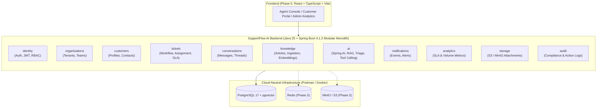

# SupportFlow AI

> **AI-Native Customer Support Platform** — Intelligent ticket management, RAG-powered knowledge assistance with citations, controlled AI agent workflows, and enterprise-grade modular monolith architecture built with Java 25 LTS and Spring Boot 4.x.

---

## Product Overview

**SupportFlow AI** is an enterprise-grade, AI-native customer support platform designed to demonstrate modern Java backend engineering, applied AI engineering with Spring AI and `pgvector`, and full-stack TypeScript/React development.

Rather than acting as a simple chatbot wrapper, SupportFlow AI integrates core customer support operations (multi-tenant organisations, omnichannel tickets, SLAs, agent workload routing, and audit trails) with grounded Retrieval-Augmented Generation (RAG), automated ticket triage, conversation summarisation, and human-in-the-loop tool calling.

---

## Feature Status

> **Transparency Note:** SupportFlow AI is developed iteratively across clearly defined milestones. Features below are marked with their actual implementation status. See [`docs/ROADMAP.md`](docs/ROADMAP.md) for detailed tracking.

| Capability | Status | Phase |
| :--- | :---: | :---: |
| Modular Monolith Backend Foundation (Java 25, Spring Boot 4.1.2, Gradle 9.9.0, Flyway) | **Implemented** | Phase 1 |
| Spring Modulith Module Boundary Verification | **Implemented** | Phase 1 |
| Baseline Identity Persistence & JWT Plumbing | **Implemented (Hardening in Phase 2)** | Phase 1 / 2 |
| Security Hardening (DTO Validation, Refresh Token Rotation, RBAC Authorities) | **Planned (Next)** | Phase 2 |
| Customer & Organisation Management | **Planned** | Phase 3 |
| Customer Support Ticket Management, Agent Assignment & SLA Escalation | **Planned** | Phase 3 |
| Conversation & Message Threads + S3 Attachments (MinIO) | **Planned** | Phase 3 |
| Knowledge Base Management & `pgvector` RAG Document Search | **Planned** | Phase 4 |
| AI Ticket Classification, Prioritisation & Summarisation | **Planned** | Phase 4 |
| AI-Generated Response Suggestions with Citations & Controlled Tool Calling | **Planned** | Phase 4 |
| Human-in-the-Loop Approval for Consequential AI Actions | **Planned** | Phase 4 |
| React + TypeScript Agent Console, Analytics & Audit Logs | **Planned** | Phase 5 |

---

## Technology Stack

### Backend (Active in Phase 1)
- **Language & Runtime:** Java 25 LTS
- **Framework:** Spring Boot 4.1.2, Spring Security, Spring Data JPA, Spring Validation, Spring Boot Actuator
- **Modular Architecture:** Spring Modulith 2.1.2
- **Database & Migrations:** PostgreSQL 17 (`pgvector/pgvector:pg17`), Flyway
- **Build Tool:** Gradle 9.9.0 (with Foojay Java Toolchain auto-provisioning)
- **Testing:** JUnit 5, Mockito, Spring Boot Test, Spring Modulith Test, Testcontainers 2.x, H2 (PostgreSQL compatibility mode for fast unit/slice tests)

### Target Stack (Phases 3–5)
- **AI Engineering:** Spring AI (OpenAI, Google Gemini, Ollama provider abstraction), PostgreSQL `pgvector`, RAG with source citations, controlled tool calling
- **Caching & Messaging:** Redis
- **Object Storage:** S3-compatible storage (MinIO locally)
- **Frontend:** React, TypeScript, Vite, Tailwind CSS, shadcn/ui, TanStack Query, React Hook Form, Zod
- **Frontend Testing:** Vitest, React Testing Library, Playwright
- **DevOps & Observability:** GitHub Actions, Podman / Docker, OpenTelemetry, structured logging

---

## Architecture Diagram



For full architectural details, see [`docs/ARCHITECTURE.md`](docs/ARCHITECTURE.md) and [`docs/TECHNICAL_DECISIONS.md`](docs/TECHNICAL_DECISIONS.md).

---

## Screenshots

*UI screenshots will be added in Phase 5 once the React + TypeScript Agent Console and Customer Portal are implemented.*

---

## Local Development Instructions

### Prerequisites
- **Java 25 LTS** (or any Java runtime — Gradle 9.9.0 automatically provisions a JDK 25 toolchain via Foojay Resolver)
- **Podman** (`podman` / `podman compose`) or **Docker** (`docker compose`)
- **Git**

### 1. Clone the Repository
```bash
git clone https://github.com/ashiksp1994/SupportFlow-AI.git
cd SupportFlow-AI
```

### 2. Configure Environment Variables
```bash
cp .env.example .env
```

### 3. Start PostgreSQL (`pgvector`) and Backend via Podman / Docker Compose
```bash
# Using Podman
podman compose up -d db

# Or using Docker
docker compose up -d db
```

### 4. Run the Spring Boot Backend Locally
```bash
cd backend
./gradlew bootRun
```
The backend starts on `http://localhost:8080` with health check at `http://localhost:8080/actuator/health`.

---

## Environment Configuration

All sensitive settings are externalised via environment variables (see [`.env.example`](.env.example)):

| Variable | Description | Local Default |
| :--- | :--- | :--- |
| `SERVER_PORT` | HTTP server port | `8080` |
| `SPRING_DATASOURCE_URL` | JDBC connection URL for PostgreSQL | `jdbc:postgresql://localhost:5432/supportflow` |
| `SPRING_DATASOURCE_USERNAME` | Database username | `supportflow` |
| `SPRING_DATASOURCE_PASSWORD` | Database password | `supportflow_dev_only` |
| `JWT_SECRET` | Base64-encoded 256-bit HMAC signing key | Local dev-only placeholder |
| `JWT_EXPIRATION_MS` | JWT validity duration in milliseconds | `3600000` |
| `CORS_ALLOWED_ORIGINS` | Comma-separated list of allowed frontend origins | `http://localhost:5173,http://localhost:3000` |

> **Security Warning:** Known pre-Phase-2 authentication vulnerabilities inherited from the legacy codebase are tracked as high-priority blockers in GitHub Issues (`#4`, `#5`, `#6`). Do **not** deploy to production until Phase 2 security hardening is complete.

---

## Testing Instructions

Run unit tests, Spring Modulith verification tests, and integration tests from the `backend/` directory:

```bash
cd backend

# Run unit & Spring Modulith verification tests
./gradlew test

# Run integration tests
./gradlew integrationTest

# Run full build and verification suite
./gradlew clean check
```

---

## Deployment Instructions

Build the multi-stage container image (runs as non-root `supportflow` user on `eclipse-temurin:25-jre-alpine`):

```bash
# Using Podman
podman build -t supportflow-backend:latest ./backend

# Using Docker
docker build -t supportflow-backend:latest ./backend
```

---

## Roadmap

See [`docs/ROADMAP.md`](docs/ROADMAP.md) for the complete milestone breakdown:
- **Phase 1:** Backend Foundation & Modernisation *(Completed)*
- **Phase 2:** Security & Authentication Hardening *(Next)*
- **Phase 3:** Core Support Domain (Organisations, Customers, Tickets, Conversations, SLA, Redis, MinIO)
- **Phase 4:** AI-Native Capabilities (Spring AI, `pgvector` RAG with Citations, Triage, Controlled Tool Calling)
- **Phase 5:** React + TypeScript Frontend Console, E2E Testing & GitHub Actions CI/CD

---

## Contributing

Please read [`CONTRIBUTING.md`](CONTRIBUTING.md) for development workflow, branching rules, testing requirements, and documentation standards.
