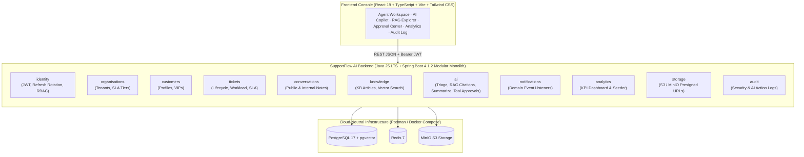

# SupportFlow AI

> **Enterprise AI-Native Customer Support Platform** — Intelligent ticket triage, RAG-powered knowledge assistance with verifiable citations, controlled AI agent tool calling with human approval gates, and a modular monolith architecture built with **Java 25 LTS**, **Spring Boot 4.1.2**, **Spring Modulith 2.1.2**, **PostgreSQL (`pgvector`)**, and **React 19 + TypeScript**.

---

## Product Overview

**SupportFlow AI** transforms customer support operations by combining enterprise support domain management with grounded, auditable AI engineering:

1. **Customer & Organisation Management** (`organisations`, `customers`): Multi-tenant organisations with tiered SLA policies (`ENTERPRISE`, `BUSINESS`, `STANDARD`), response/resolution targets, and VIP customer profiles.
2. **Customer Support Ticket Management** (`tickets`): Full ticket lifecycle (`OPEN`, `IN_PROGRESS`, `ESCALATED`, `RESOLVED`, `CLOSED`), automatic SLA deadline calculation, and breach tracking.
3. **Agent Assignment & Workload Management** (`tickets`): Real-time agent assignment and active/high-priority/escalated workload balancing.
4. **Omnichannel Conversation & Message Management** (`conversations`): Public customer/agent threads alongside internal-only agent notes and AI-assisted draft replies.
5. **SLA Tracking & Event-Driven Escalation** (`tickets`, `notifications`): Automated SLA calculation and domain-event notifications when tickets are created or escalated.
6. **AI Ticket Classification & Prioritisation** (`ai`): Semantic classification of ticket category, priority, urgency sentiment, confidence score, and triage reasoning.
7. **Knowledge Base Management** (`knowledge`): Technical resolution article authoring, tagging, and automatic semantic vector embedding computation.
8. **RAG-Powered Document Search** (`knowledge`): Hybrid vector cosine similarity + lexical search returning ranked knowledge base articles with similarity scores and citation snippets.
9. **AI-Generated Response Suggestions with Citations** (`ai`): Synthesizes grounded customer replies with inline `[KB-xxx]` citations and structured source metadata.
10. **Conversation Summarisation** (`ai`): Generates executive handoff summaries, key customer pain points, and recommended next steps.
11. **AI Agents with Controlled Tool Calling** (`ai`): Supports consequential tools (`ESCALATE_TO_TIER3_ENGINEERING`, `ISSUE_SLA_CREDIT_REFUND`, `RESOLVE_AND_CLOSE_TICKET`).
12. **Human-in-the-Loop Approval for Consequential Actions** (`ai`): Consequential AI tool calls enter a `PENDING` governance queue and execute only after an authorized `AGENT` or `ADMIN` approves them.
13. **Support Analytics & Reporting** (`analytics`): Real-time KPI dashboard (ticket volume by priority, SLA compliance rate, AI triage coverage, pending approvals, agent workloads).
14. **Immutable Audit Logs & Role-Based Access Control** (`identity`, `audit`): Hardened JWT authentication, refresh token rotation, `@EnableMethodSecurity` RBAC (`CUSTOMER`, `AGENT`, `ADMIN`), and tamper-evident audit logging.

---

## Feature Implementation Matrix

| Feature / Capability | Module | Status | Phase |
| :--- | :--- | :---: | :---: |
| Java 25 + Spring Boot 4.1.2 + Spring Modulith 2.1.2 + Flyway Foundation | `backend` | **Implemented & Verified** | Phase 1 |
| Hardened JWT Auth, Refresh Token Rotation, RBAC & DTO Validation | `identity` | **Implemented & Verified** | Phase 2 |
| Immutable Security & AI Governance Audit Trail (`/api/audit-logs`) | `audit` | **Implemented & Verified** | Phase 2 |
| Multi-Tenant Organisations & Tiered SLA Policies (`/api/organisations`) | `organisations` | **Implemented & Verified** | Phase 3 |
| Customer Profiles & VIP Escalation Rules (`/api/customers`) | `customers` | **Implemented & Verified** | Phase 3 |
| Support Tickets, Agent Workload & SLA Escalation (`/api/tickets`) | `tickets`, `notifications` | **Implemented & Verified** | Phase 3 |
| Omnichannel Conversations & S3/MinIO Attachments (`/api/tickets/{id}/messages`) | `conversations`, `storage` | **Implemented & Verified** | Phase 3 |
| Knowledge Base & Vector/Hybrid RAG Search (`/api/knowledge`) | `knowledge` | **Implemented & Verified** | Phase 4 |
| AI Ticket Triage, RAG Replies with Citations & Summarisation (`/api/ai`) | `ai` | **Implemented & Verified** | Phase 4 |
| Controlled AI Agent Tool Calling & Human Approval Gate (`/api/ai/approvals`) | `ai` | **Implemented & Verified** | Phase 4 |
| Executive Support Analytics & Demo Data Seeder (`/api/analytics/dashboard`) | `analytics` | **Implemented & Verified** | Phase 5 |
| React 19 + TypeScript + Vite + Tailwind CSS + TanStack Query Console | `frontend` | **Implemented & Verified** | Phase 5 |
| GitHub Actions CI/CD & Cloud-Neutral Podman/Docker Compose Stack | `.github/workflows` | **Implemented & Verified** | Phase 5 |

---

## Architecture Diagram



---

## Local Development & Quick Start

### Option A: Instant Self-Contained Live Demo (No Container Daemon Required)
The backend includes a `demo` profile that runs with an in-memory PostgreSQL-compatible database, executes all Flyway migrations (`V1`–`V4`), and seeds realistic Enterprise organisations, tickets, knowledge base articles, and pending AI tool approvals:

```bash
# Terminal 1: Start the Java 25 Spring Boot Backend on port 8080
cd backend
./gradlew bootRun --args='--spring.profiles.active=demo'

# Terminal 2: Start the React + TypeScript Frontend on port 5173
cd frontend
npm install
npm run dev
```
Open `http://localhost:5173` and sign in with the pre-seeded demo credentials:
- **Principal Support Engineer:** `sarah.chen` / `SupportFlow!2026`
- **Platform Admin:** `admin` / `SupportFlow!2026`

### Option B: Full Container Stack via Podman / Docker Compose
```bash
cp .env.example .env
podman compose up -d --build
# Or: docker compose up -d --build
```

---

## Testing Instructions

### Backend (JUnit 5, Spring Modulith Verification, MockMvc Security & Integration Tests)
```bash
cd backend
./gradlew clean build check --no-daemon
```

### Frontend (Vitest, React Testing Library & TypeScript Production Build)
```bash
cd frontend
npm test
npm run build
```

---

## Documentation Links

- [`docs/ARCHITECTURE.md`](docs/ARCHITECTURE.md) — Modular monolith design, module boundaries, and database schema.
- [`docs/ROADMAP.md`](docs/ROADMAP.md) — Completed phases (Phases 1–5) and future enhancements.
- [`docs/PROJECT_LOG.md`](docs/PROJECT_LOG.md) — Chronological engineering log across all phases.
- [`docs/TECHNICAL_DECISIONS.md`](docs/TECHNICAL_DECISIONS.md) — Architecture Decision Records (ADRs).
- [`CHANGELOG.md`](CHANGELOG.md) — Versioned release history.
- [`CONTRIBUTING.md`](CONTRIBUTING.md) — Engineering and contribution guidelines.
