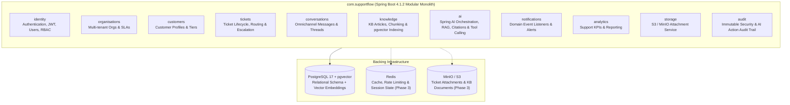

# SupportFlow AI — Architecture Documentation

## 1. Architectural Style: Modular Monolith

SupportFlow AI is architected as a **Modular Monolith** built on **Java 25 LTS**, **Spring Boot 4.1.2**, and **Spring Modulith 2.1.2**.

All domain capabilities execute within a single deployable JVM process (`supportflow-backend`) with explicit, compile-time and test-time verified module boundaries (`ApplicationModules.of(SupportFlowApplication.class).verify()`).



---

## 2. Module Responsibilities

| Module (`com.supportflow.*`) | Responsibility | Phase |
| :--- | :--- | :---: |
| `identity` | User accounts, authentication, JWT issuance/validation, role-based access control (RBAC). | Phase 1 / 2 |
| `organisations` | Customer organisations, support teams, SLA policies, and tenant metadata. | Phase 3 |
| `customers` | End-user customer profiles, organisation membership, and support history. | Phase 3 |
| `tickets` | Support ticket state machine, priority, category, agent assignment, and SLA tracking. | Phase 3 |
| `conversations` | Ticket message threads, internal agent notes, and customer replies. | Phase 3 |
| `storage` | Presigned URLs and metadata for ticket attachments and knowledge base files in S3/MinIO. | Phase 3 |
| `notifications` | Asynchronous event-driven notifications for ticket assignments and SLA breaches. | Phase 3 |
| `knowledge` | Knowledge base articles, document chunking, and vector embedding lifecycle in `pgvector`. | Phase 4 |
| `ai` | AI ticket triage, RAG answer generation with source citations, conversation summarisation, and controlled tool calling with human approval gates. | Phase 4 |
| `analytics` | Resolution time, SLA compliance, AI deflection/assistance metrics, and agent workload reports. | Phase 5 |
| `audit` | Tamper-evident audit logs for authentication events, privilege changes, and AI tool executions. | Phase 2 / 4 |

---

## 3. Current Phase 1 Package Layout

```text
backend/
├── build.gradle
├── settings.gradle
├── Dockerfile
└── src/
    ├── main/
    │   ├── java/com/supportflow/
    │   │   ├── SupportFlowApplication.java
    │   │   ├── identity/
    │   │   │   ├── package-info.java
    │   │   │   ├── controller/AuthController.java
    │   │   │   ├── model/UserModel.java
    │   │   │   ├── repository/UserRepository.java
    │   │   │   ├── security/{JwtRequestFilter,JwtUtils,WebSecurityConfig}.java
    │   │   │   └── service/{UserDetailsServiceImpl,UserService}.java
    │   │   ├── organisations/package-info.java
    │   │   ├── customers/package-info.java
    │   │   ├── tickets/package-info.java
    │   │   ├── conversations/package-info.java
    │   │   ├── knowledge/package-info.java
    │   │   ├── ai/package-info.java
    │   │   ├── notifications/package-info.java
    │   │   ├── analytics/package-info.java
    │   │   ├── storage/package-info.java
    │   │   └── audit/package-info.java
    │   └── resources/
    │       ├── application.properties
    │       └── db/migration/V1__init_user_schema.sql
    ├── test/
    │   ├── java/com/supportflow/
    │   │   ├── SupportFlowApplicationTests.java
    │   │   └── identity/{ProfileTest,UserModelTest}.java
    │   └── resources/application-test.properties
    └── integrationTest/
        ├── java/com/supportflow/identity/UserServiceIntegrationTest.java
        └── resources/application-integration.properties
```

---

## 4. Database & Migration Strategy

- **Primary Database:** PostgreSQL 17 with the `pgvector` extension (`pgvector/pgvector:pg17`), enabling unified ACID storage for both relational domain entities and vector embeddings.
- **Schema Management:** Managed exclusively by **Flyway** (`src/main/resources/db/migration/V*__*.sql`). Hibernate is restricted to `spring.jpa.hibernate.ddl-auto=validate` across all environments (including tests) to guarantee zero drift between Flyway migrations and JPA entities.
