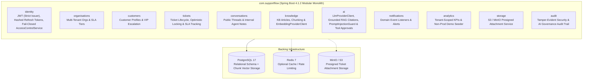

# SupportFlow AI — Architecture Documentation

## 1. Architectural Style: Modular Monolith

SupportFlow AI is architected as a **Modular Monolith** built on **Java 25 LTS**, **Spring Boot 4.1.2**, and **Spring Modulith 2.1.2**.

All domain capabilities execute within a single deployable JVM process (`supportflow-backend`) with explicit, compile-time and test-time verified module boundaries (`ApplicationModules.of(SupportFlowApplication.class).verify()`).

---

## 2. Module Responsibilities

| Module (`com.supportflow.*`) | Responsibility |
| :--- | :--- |
| `identity` | User accounts, BCrypt password hashing, JWT issuance/validation with strict `iss=supportflow-ai` enforcement, SHA-256 refresh token hashing & reuse revocation, login rate limiting, and fail-closed multi-tenant RBAC via [`AccessControlService`](../backend/src/main/java/com/supportflow/identity/security/AccessControlService.java). |
| `organisations` | Customer organisations, SLA tiers (`ENTERPRISE`, `BUSINESS`, `STANDARD`), and tenant isolation. |
| `customers` | Customer profiles, organisation membership, and VIP SLA escalation rules. |
| `tickets` | Support ticket state machine, optimistic locking (`@Version`), agent workload balancing, and SLA breach calculation. |
| `conversations` | Ticket message threads, customer replies, and internal agent notes (filtered from `CUSTOMER` responses). |
| `storage` | Presigned upload/download URL generation and attachment metadata persistence (`ticket_attachments`). |
| `notifications` | Spring Modulith event-driven listeners for `TicketCreatedEvent` and `TicketEscalatedEvent`. |
| `knowledge` | Knowledge base articles (`knowledge_articles`), paragraph/sentence chunk segmentation (`knowledge_chunks`), and hybrid vector + lexical retrieval via [`EmbeddingProviderClient`](../backend/src/main/java/com/supportflow/knowledge/EmbeddingProviderClient.java). |
| `ai` | Grounded AI ticket triage, RAG reply generation with citations and insufficient-evidence refusal, conversation summarisation, [`PromptInjectionGuard`](../backend/src/main/java/com/supportflow/ai/PromptInjectionGuard.java), [`AllowedAiTool`](../backend/src/main/java/com/supportflow/ai/AllowedAiTool.java) allowlist validation, and human-in-the-loop approval execution via [`LlmProviderClient`](../backend/src/main/java/com/supportflow/ai/LlmProviderClient.java). |
| `analytics` | Tenant-scoped support KPI dashboard (`getDashboardAnalytics`) and `@Profile("!prod")` demo data seeder. |
| `audit` | Audit logging for authentication, ticket mutations, prompt-injection detections, and AI tool approvals. |

---

## 3. AI, RAG & Embedding Architecture (Implementation Honesty)

SupportFlow AI implements a lightweight, dependency-clean Java 25 HTTP AI & RAG pipeline designed to operate both with live OpenAI-compatible endpoints and in €0/month offline/portfolio environments:

1. **LLM Provider Abstraction ([`LlmProviderClient`](../backend/src/main/java/com/supportflow/ai/LlmProviderClient.java)):**
   - Uses Java's built-in `java.net.http.HttpClient` with configurable timeouts (`app.ai.llm.timeout-seconds`) to call OpenAI-compatible `/v1/chat/completions` endpoints (`OpenAI`, `Groq`, `Ollama`, or `Gemini OpenAI-compat`) when `AI_LLM_API_KEY` (`app.ai.llm.api-key`) is configured and `app.ai.llm.provider` is not `local-grounded`.
   - When no external API key is configured (or if an upstream provider fails), it falls back to deterministic grounded synthesis (`supportflow-grounded-v2`).
   - **Full Fallback Transparency:** Every `AiTriageResult`, `RagReplySuggestion`, and `ConversationSummaryResult` explicitly returns `providerUsed`, `modelUsed`, and `fallbackUsed` (`true`/`false`), which the React UI renders as a visible badge (`Mode: Local Deterministic Fallback` vs. `Provider: <provider> (<model>)`).

2. **Chunk Indexing & Embedding Abstraction ([`EmbeddingProviderClient`](../backend/src/main/java/com/supportflow/knowledge/EmbeddingProviderClient.java) & [`KnowledgeService`](../backend/src/main/java/com/supportflow/knowledge/KnowledgeService.java)):**
   - Published articles are segmented into ~360-character paragraph/sentence chunks stored in `knowledge_chunks`.
   - When an external API key is configured, `EmbeddingProviderClient` requests embeddings from `/v1/embeddings`; otherwise it computes a normalized 12-dimension domain concept vector (`supportflow-concept-12d`).
   - Vectors are persisted as comma-separated floats in `TEXT` columns (`embedding_vector TEXT`) so the exact same Flyway migrations (`V1`–`V6`) and hybrid cosine + lexical retrieval logic execute identically on both PostgreSQL 17 and H2 (`MODE=PostgreSQL`) in CI/demo mode without requiring native `pgvector` SQL operators at query time.

---

## 4. Database & Migration Strategy

- **Primary Database:** PostgreSQL 17 (`pgvector/pgvector:pg17` container image in `docker-compose.yml`, or Neon Serverless PostgreSQL in cloud deployments).
- **Schema Management:** Managed exclusively by **Flyway** (`src/main/resources/db/migration/V1__*.sql` through `V6__*.sql`):
  - `V1__init_user_schema.sql`: Initial `user_details` table.
  - `V2__refresh_tokens_and_audit_logs.sql`: `refresh_tokens` and `audit_logs` tables.
  - `V3__core_support_domain_schema.sql`: `organisations`, `customer_profiles`, `tickets`, `conversation_messages`, `ticket_attachments`.
  - `V4__knowledge_base_and_ai_governance.sql`: `knowledge_articles` and `ai_approval_requests`.
  - `V5__multi_tenancy_rag_chunks_and_locking.sql`: Multi-tenant `organisation_id` columns, optimistic locking `version` columns, `knowledge_chunks` table, and composite tenant indexes.
  - `V6__drop_legacy_patient_user_columns.sql`: Drops legacy columns from `user_details`.
- **Strict Validation:** Hibernate runs with `spring.jpa.hibernate.ddl-auto=validate` across all profiles (`default`, `test`, `integration`, `prod`) to guarantee zero drift between Flyway migrations and JPA entities.
