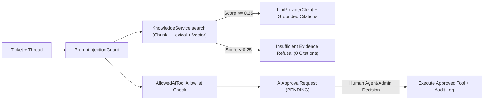

# SupportFlow AI — AI, Grounded RAG & Agent Governance Audit (`AI_AUDIT.md`)

**Audit Phase:** Phase 4  
**Date:** 2026-11-10  
**Scope:** LLM Provider Abstraction, Document Chunking, Hybrid Semantic/Lexical RAG Retrieval, Hallucination Prevention, Prompt Injection Defense, and Human-in-the-Loop Tool Governance.

---

## 1. AI & RAG Architecture

---

## 2. Remediated AI Findings (`AI-001`, `AI-002`)

1. **Eliminated Unconditional Citation Fabrication (`AI-001`):**
   - Removed the previous `Math.max(0.15, combinedScore)` floor in `KnowledgeService.search`.
   - Enforced a configurable minimum relevance threshold (`app.ai.rag.min-relevance-threshold=0.25`) requiring both lexical/semantic signal.
   - When `KnowledgeService.search` returns `[]`, `AiOrchestrationService.suggestReplyWithCitations` returns `citations: []`, logs `AI_RAG_INSUFFICIENT_EVIDENCE`, and instructs the support engineer that the knowledge base lacks verified grounding for the query.
2. **Document Chunking (`knowledge_chunks`):**
   - Added `KnowledgeChunk` entity and `knowledge_chunks` table (`V5` migration).
   - `KnowledgeService.createArticle` segments articles into paragraph/sentence chunks (`<= 360` chars) and indexes chunk-level vectors for fine-grained snippet extraction.
3. **Configurable External LLM Client with Deterministic Fallback (`LlmProviderClient`):**
   - Implemented `LlmProviderClient.java` using `java.net.http.HttpClient` with 8-second timeouts against OpenAI-compatible `/chat/completions` endpoints (`app.ai.llm.base-url`, `app.ai.llm.api-key`, `app.ai.llm.model`), falling back cleanly to the deterministic grounded engine when no external key is configured.
4. **Prompt Injection Defense (`PromptInjectionGuard`) & Tool Allowlist (`AllowedAiTool`):**
   - `PromptInjectionGuard` detects instruction-override, jailbreak, secret-exfiltration, and unauthorized tool-execution patterns, redacting them and blocking tool proposals on flagged inputs (`AI_TOOL_PROPOSAL_BLOCKED_INJECTION`).
   - `AllowedAiTool` restricts tool proposals to 4 audited tools (`ISSUE_SLA_SERVICE_CREDIT`, `ESCALATE_TO_TIER3_ENGINEERING`, `UPDATE_SLA_TIER`, `CLOSE_DUPLICATE`) and validates `parametersJson`.
